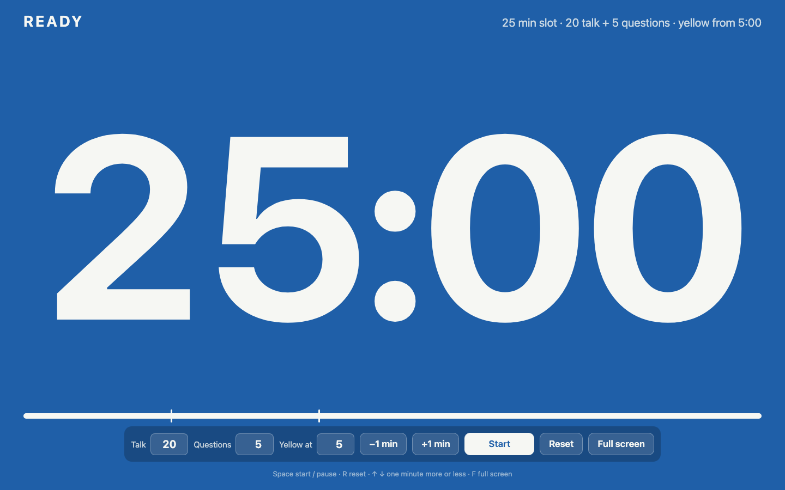

# Session Countdown

A full-screen countdown clock for conference sessions. It shows a talk slot to the
speaker in colors that read from the back of the room:

| Color | When |
|---|---|
| Blue | Ready: shows the whole slot, e.g. 25:00 |
| Green | The talk, counting down from 20:00 |
| Yellow | The last 5 minutes of the talk |
| Red | Questions, counting down from 5:00 |
| Red, pulsing | Time is up: counts the overtime as +0:42 |

**Use it online:** https://zevahcle.github.io/session-countdown/

**Install it as an app.** Once installed it has its own icon, opens full
screen without the browser bars, and works with no connection:

- Chrome or Edge, desktop or Android: the **Install app** button on the clock,
  or the install icon in the address bar.
- iPhone or iPad: open the link in Safari, then Share › Add to Home Screen.

**Or keep a single file:** download [`index.html`](index.html) and open it in
any browser. It needs nothing else to run.

## Controls

- **Talk**, **Questions** and **Yellow at** are in minutes (decimals work: 7.5).
  The defaults are 20, 5 and 5.
- **Start**, **Pause** and **Reset**. Reset goes back to the planned slot for the next speaker.
- **+1 min** and **−1 min** change the part that is running: the talk during the
  talk, the questions after it.
- **Full screen** where the browser allows it.
- While the clock runs, the controls fade after 3 seconds; move the mouse or tap
  to bring them back.

Keyboard: Space starts or pauses, R resets, ↑ and ↓ add or remove a minute,
F toggles full screen.

The clock keeps running across a page reload, and it asks the browser to keep
the screen awake while it runs. The browser bar (and a phone's status bar)
takes the color of the current phase.

## Files

| File | What it is |
|---|---|
| `index.html` | the whole clock |
| `manifest.webmanifest`, `sw.js` | what makes it installable and offline |
| `icon*.png`, `icon.svg`, `apple-touch-icon.png` | app icons, drawn by `tools/icons.py` |

## License

MIT
